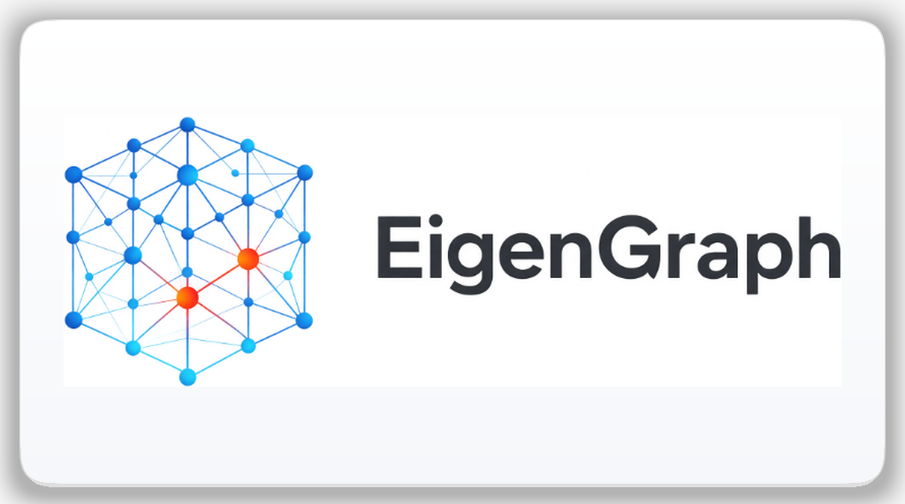

<div align="center">



# 🌐 EigenGraph Web Workstation

### High-Performance 10D BIM & Structural Graph Analytics Running Natively in WebAssembly (Rust + egui/eframe)

[](https://eigengraph.net/)
[-orange?style=for-the-badge&logo=rust&logoColor=white)](https://github.com/EigenGraph/EigenGraph)
[](LICENSE)

*Full Rust/egui **EigenGraph** 10D BIM & Structural Mechanics Workstation compiled to WebAssembly (`wasm32-unknown-unknown`) via `eframe` and `Trunk`, with responsive navigation across Desktop, Tablet, and Mobile.*

[**Launch EigenGraph Web App ↗**](https://eigengraph.net/) • [**Mirror (`www`) ↗**](https://www.eigengraph.net/)

</div>

> [!IMPORTANT]
> **Disclaimer**: *EigenGraph is an experimental computational engineering and BIM platform currently under active development. Features, architecture, and capabilities are subject to change.*

---

## 🏛️ Overview

**EigenGraph** (`EigenGraph/EigenGraph`) is a client-side **WebAssembly + WebGL2** 10D BIM and structural mechanics workstation compiled cleanly from Rust (`v0.3.6`, Phase 36 Personal Vault Onboarding, Web FS/IndexedDB Bridge, Top-Toolbar Inspectors & Geometry 3D Earth Map) and deployed automatically to **Cloudflare Workers**.

### 15 Engineering Modules
1. **📁 My Library** — Project records, parametric component catalog, interactive HTML5 3D viewer & Markdown dossier browser downloads.
2. **🤖 AI Agent** — Virtual engineering firm & multi-agent collaboration board.
3. **💡 Research** — Interactive Slippy Map (Web Mercator Quadtree), WGS84/UTM geodetic CRS transformations, and DEM topographic TIN mesh.
4. **📐 Parametric** — 2D vector CAD studio with magnetic snaps, live 3D solid extrusion companion, and PDF/SVG/IFC4 exports.
5. **🏗️ Geometry** — Clean BIM spatial assembly across multi-level Z-planes and structural grids.
6. **⚡ Analysis** — 3D FEM solver, Sherman-Morrison $O(N^2)$ linear ARI, Woodbury rank-2 ($N-2$) disruption screening, SVD kinematic mechanism guard, pushover, nonlinear time-history, seismic isolation, geotech/SSI, blast, and fire engineering.
7. **⏱️ Time & Scheduling** — 4D phased erection timeline, CPM scheduling, and S-Curve tracking.
8. **💰 Cost & Budgeting** — 5D cost heatmap, Quantity Take-Off (QTO), and parametric BoQ.
9. **🌱 Sustainability & Energy** — 6D solar heliodon sun-path analysis and cradle-to-gate embodied carbon LCA.
10. **🏢 Facility Management** — 7D Digital Twin spatial asset tagging and telemetry logs.
11. **🛡️ Safety & Health** — 8D tower crane sweep envelopes and slab-edge hazard guards.
12. **♻️ Lean Construction** — 9D material staging, 1D Cutting Stock Optimizer (CSO), and Bar Bending Schedules (BBS).
13. **🤖 Industrialized & Automation** — 10D DfMA modular prefabrication, OpenBIM IFC 4.3 STEP parser/editor, clash detection, model diff, and IDS validation.
14. **🔮 Prediction** — Structural stress concentration forecasts and aging risk diagnostics.
15. **📑 Report** — Living publishing suite for engineering docs, spreadsheets, and executive decks.

---

## 📁 Repository Structure

```text
EigenGraph/
├── .github/workflows/deploy.yml   # Test, Trunk WASM build & Cloudflare Workers deploy
├── assets/
│   └── *.png                      # Web favicon & runtime app icons/logos
├── docs/
│   └── CHANGELOG.md               # Versioned changelog across development phases
├── src/                           # Rust core mechanics, egui views, WebAssembly bridge
├── Cargo.toml                     # Rust package manifest & dependencies
├── Trunk.toml                     # WebAssembly build configuration
├── wrangler.jsonc                 # Cloudflare Workers Static Assets deployment config
└── index.html                     # Responsive HTML5 WebGL2 shell
```

---

## 💻 Local Development

### Run as Full WebAssembly Web App
```bash
# Install the WebAssembly Rust target and Trunk bundler
rustup target add wasm32-unknown-unknown
cargo install --locked trunk

# Serve locally with live reload
trunk serve --public-url / --open
```

### Run Automated Tests & Checks
```bash
cargo test --lib
cargo check --bin eigengraph --target wasm32-unknown-unknown
```

---

## 🚀 Continuous Deployment (Cloudflare Workers)

Every push to `main` triggers [`.github/workflows/deploy.yml`](.github/workflows/deploy.yml):
1. Runs `cargo test --lib` and verifies `cargo check --bin eigengraph --target wasm32-unknown-unknown`.
2. Builds the optimized WebAssembly bundle with `trunk build --release --public-url /`.
3. Deploys `./dist` via Wrangler to Cloudflare Workers (`eigengraph.net` and `www.eigengraph.net`).

---

## 📚 Documentation

- [Changelog](docs/CHANGELOG.md)
- [Agent & Architecture Guidelines](AGENTS.md)

---

## 📄 License

Copyright © 2026 Harids Irawan.  
Dual-licensed under the [MIT License](LICENSE) and [Apache License 2.0](LICENSE).
